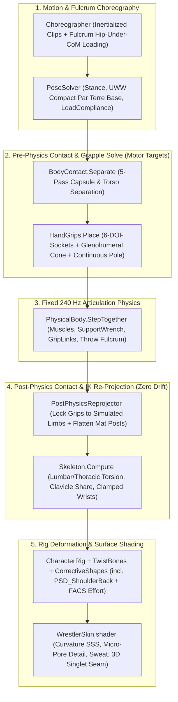

# Production-Grade Biomechanics, Contact & Visual Fidelity Plan (Phase 2)

This document specifies the architectural plan to resolve the remaining biomechanical, anatomical, contact-solving, and close-up rendering gaps identified in the post-refactoring audit (**71/100 → 92+/100**), following the repository's core engineering rules ([`CLAUDE.md`](../CLAUDE.md)):

- **Zero Technical Debt:** No ad-hoc per-technique magic offsets, no frame-rate-dependent heuristics, and no bypasses of the physical articulation solver.
- **Deterministic Core Isolation:** [`Wrestling.Core`](../src/Wrestling.Core) remains pure C# (`Fix64` / `Pcg32`) with zero presentation dependencies.
- **Data-Driven & Validated Content:** Clip timing, fulcrum heights, and physical velocity bounds are enforced by automated content validation in [`Wrestling.Data`](../src/Wrestling.Data) and measured in [`PhysicsLab`](../unity/WrestlingSimulator/Assets/Scripts/Editor/PhysicsLab.cs).

---

## 1. Root-Cause Summary & Architectural Principles

| # | Observed Defect in Renders | Root Cause in Current Pipeline | Architectural Fix (No Tech Debt) |
|---|---|---|---|
| **1** | **Hand/finger penetration & floating on grips** ([`bout-greco-roman-close-up-hands.png`](images/bout-greco-roman-close-up-hands.png), [`bout-freestyle-throw-grips.png`](images/bout-freestyle-throw-grips.png)) | [`BoutViewer.PlayFrame`](../unity/WrestlingSimulator/Assets/Scripts/Presentation/BoutViewer.cs) solves [`HandGrips.Place`](../unity/WrestlingSimulator/Assets/Scripts/Presentation/HandGrips.cs) *before* [`PhysicalBody.StepTogether`](../unity/WrestlingSimulator/Assets/Scripts/Presentation/PhysicalBody.cs). When the 240 Hz ragdoll diverges by 3–8 cm under load, only socket rotations are updated—wrist positions are never re-solved against the post-physics limb transforms. | **Two-Stage Pre/Post-Physics Grapple IK:** Pre-physics IK sets motor targets and `GripLink` anchors; a lightweight post-physics analytical two-bone arm + posted-wrist IK pass re-anchors hands to the exact simulated opponent/mat surfaces before [`Skeleton.Compute`](../unity/WrestlingSimulator/Assets/Scripts/Presentation/Skeleton.cs). |
| **2** | **Posterior shoulder / axilla mesh pinching & arm twisting in throws and turns** ([`bout-womens-throw-grips.png`](images/bout-womens-throw-grips.png), [`bout-freestyle-par-terre-turn.png`](images/bout-freestyle-par-terre-turn.png)) | [`HandGrips.PlaceArm`](../unity/WrestlingSimulator/Assets/Scripts/Presentation/HandGrips.cs) solves unconstrained two-bone IK when the thrower turns 160°–180° away from the held head/arm, driving humeral posterior extension >110° with a static pole vector, and [`CorrectiveShapeBaker`](../unity/WrestlingSimulator/Assets/Scripts/Editor/CorrectiveShapeBaker.cs) lacks posterior shoulder PSD shapes. | **Scapulohumeral Rhythm & Cone Constraint + Posterior PSD:** Enforce an anatomical glenohumeral cone limit in [`PoseSolver`](../unity/WrestlingSimulator/Assets/Scripts/Presentation/PoseSolver.cs) / [`HandGrips`](../unity/WrestlingSimulator/Assets/Scripts/Presentation/HandGrips.cs), transfer excess reach into clavicle retraction/protraction, compute continuous torso-tangent elbow pole vectors, and bake `PSD_ShoulderBack_L/R` at import time. |
| **3** | **Twisted grounded wrists & high "tabletop" par terre defensive base** ([`bout-freestyle-close-up.png`](images/bout-freestyle-close-up.png), [`bout-womens-par-terre.png`](images/bout-womens-par-terre.png)) | [`PoseSolver.Kneeling`](../unity/WrestlingSimulator/Assets/Scripts/Presentation/PoseSolver.cs) poses `BothKnees` as an open hands-and-knees quadruped (`hipHeight` 0.28–0.52 m) and sets posted hand normals before [`BodyContact.Separate`](../unity/WrestlingSimulator/Assets/Scripts/Presentation/BodyContact.cs) shifts the elbows. | **Anatomical UWW Par Terre Base & Post-Contact Grounded Limb Projection:** Distinguish active kneeling (`OneKnee` / attacking `BothKnees`) from compact defensive par terre (hips sunk on heels, forearms/elbows flat on mat, tight axillary seal), and re-align planted hands/feet with the mat normal after contact separation and physics. |
| **4** | **Thrower hips above opponent CoM & unphysical clip accelerations** ([`bout-womens-throw.png`](images/bout-womens-throw.png), [`bout-freestyle-throw-sequence.png`](images/bout-freestyle-throw-sequence.png), sprawl clip) | Keyed clips in [`data/animation/`](../data/animation) leave thrower `posture` upright (`0.8`) with `pitch: 0` during hip/headlock loading, seat fireman's carries too low (`ThrowRadius = 0.22f`), and drop sprawl hips 0.6 m in half a phase while adding `lift: 0.18`. | **Biomechanical Fulcrum Kinematics & Content Validator:** Define explicit fulcrum geometry (`ThrowAnchor` height + forward hip-under-CoM offset + trunk forward pitch) in [`Choreographer`](../unity/WrestlingSimulator/Assets/Scripts/Presentation/Choreographer.cs), update throw/sprawl clips in [`data/animation/`](../data/animation), and enforce human acceleration/fulcrum invariants in [`Wrestling.Data`](../src/Wrestling.Data) tests. |
| **5** | **Vacant slack-jawed faces & smooth poreless skin in close-ups** ([`bout-greco-roman-close-up.png`](images/bout-greco-roman-close-up.png), [`bout-womens-close-up.png`](images/bout-womens-close-up.png)) | [`CharacterRig.ApplyEffort`](../unity/WrestlingSimulator/Assets/Scripts/Presentation/CharacterRig.cs) rotates the `jaw` bone open up to 11° with zero facial muscle tension, and [`WrestlerSkin.shader`](../unity/WrestlingSimulator/Assets/Presentation/Shaders/WrestlerSkin.shader) has no micro-normal pore detail when a MakeHuman skin lacks a normal map. | **FACS Exertion BlendShapes & Procedural Skin Micro-Relief:** Export 6 FACS exertion shape keys (`Effort_BrowFurrow`, `Effort_Squint`, `Effort_NostrilFlare`, `Effort_JawClench`, `Effort_LipPress`, `Effort_Grimace`) in [`build_wrestlers.py`](../tools/characters/build_wrestlers.py), drive them in [`CharacterRig`](../unity/WrestlingSimulator/Assets/Scripts/Presentation/CharacterRig.cs), and add UV-space Voronoi/cellular pore micro-normals in [`WrestlerSkinLighting.hlsl`](../unity/WrestlingSimulator/Assets/Presentation/Shaders/WrestlerSkinLighting.hlsl). |

---

## 2. Target Pipeline Architecture

---

## 3. Detailed Workstreams

### Workstream 1: Post-Physics Grapple & Mat Contact Re-Projection
**Goal:** Eliminate the 3–8 cm visual gap or mesh penetration between a wrestler's hands/wrists and the opponent's simulated body (or the mat) without feeding presentation adjustments back into the physics state.

**Files to Modify:**
- [`unity/WrestlingSimulator/Assets/Scripts/Presentation/BoutViewer.cs`](../unity/WrestlingSimulator/Assets/Scripts/Presentation/BoutViewer.cs)
- [`unity/WrestlingSimulator/Assets/Scripts/Presentation/HandGrips.cs`](../unity/WrestlingSimulator/Assets/Scripts/Presentation/HandGrips.cs)
- [`unity/WrestlingSimulator/Assets/Scripts/Presentation/BodyContact.cs`](../unity/WrestlingSimulator/Assets/Scripts/Presentation/BodyContact.cs)

**Design & Implementation:**
1. **Separate Physics Target Pose from Display Pose in [`BoutViewer.PlayFrame`](../unity/WrestlingSimulator/Assets/Scripts/Presentation/BoutViewer.cs):**
   - Keep the pre-physics pipeline (`PoseSolver.Solve` → `BodyContact.Separate` → `HandGrips.Place`) intact as the **motor target pose** passed to `PhysicalBody.StepTogether`.
   - After `PhysicalBody.StepTogether` writes the simulated segment transforms into `redPose` and `bluePose`, run a deterministic display-only **post-physics re-projection pass** before `Skeleton.Compute`:
     - Re-evaluate [`HandGrips.Place`](../unity/WrestlingSimulator/Assets/Scripts/Presentation/HandGrips.cs) (and `PlaceThrowGrips` / `PlaceCounterGrips` when active) using the **post-physics** `redPose` and `bluePose` and the active `GripLink` anchor points (`_redBody.GripTarget(Left/Right)`), solving two-bone analytical arm IK from the simulated shoulder position to the simulated socket.
     - Re-run planted foot, knee, and posted-hand ground clamping in [`BodyContact.ReprojectGroundedLimbs`](../unity/WrestlingSimulator/Assets/Scripts/Presentation/BodyContact.cs) so any hand posted on the mat (`HandL.y <= 0.08f` with `LeftGripStyle == HandGripStyle.OpenGuard` and no active grip) has its wrist height, `PalmNormal = Vector3.down`, and `HandDir` projected onto the mat plane orthogonal to the post-physics forearm axis.
2. **Continuous Wrist-to-Forearm Alignment (`Skeleton.Wrist`):**
   - In [`Skeleton.Wrist`](../unity/WrestlingSimulator/Assets/Scripts/Presentation/Skeleton.cs), when a hand is posted on the mat, compute `HandDir` by projecting the forearm-to-hand forward vector onto the horizontal mat plane and blending toward the chest facing direction when the forearm is nearly vertical, preventing the 90° radial twist seen in [`bout-freestyle-close-up.png`](images/bout-freestyle-close-up.png).

---

### Workstream 2: Glenohumeral Cone Constraint, Continuous Pole Vectors & Posterior Shoulder PSD
**Goal:** Eliminate armpit/deltoid mesh collapse and candy-wrapper shoulder creasing during headlock throws, cross-body locks, and par terre turns.

**Files to Modify:**
- [`unity/WrestlingSimulator/Assets/Scripts/Presentation/PoseSolver.cs`](../unity/WrestlingSimulator/Assets/Scripts/Presentation/PoseSolver.cs)
- [`unity/WrestlingSimulator/Assets/Scripts/Presentation/HandGrips.cs`](../unity/WrestlingSimulator/Assets/Scripts/Presentation/HandGrips.cs)
- [`unity/WrestlingSimulator/Assets/Scripts/Editor/CorrectiveShapeBaker.cs`](../unity/WrestlingSimulator/Assets/Scripts/Editor/CorrectiveShapeBaker.cs)
- [`unity/WrestlingSimulator/Assets/Scripts/Presentation/CorrectiveShapes.cs`](../unity/WrestlingSimulator/Assets/Scripts/Presentation/CorrectiveShapes.cs)
- [`unity/WrestlingSimulator/Assets/Scripts/Editor/DeformationSheet.cs`](../unity/WrestlingSimulator/Assets/Scripts/Editor/DeformationSheet.cs)

**Design & Implementation:**
1. **Anatomical Glenohumeral Reach Cone (`PoseSolver.ClampShoulderReach`):**
   - Define the shoulder's anatomical reach cone in the upper torso frame `(chestRight, spineUp, chestForward)`:
     - Maximum posterior extension behind the coronal plane: `42°` (beyond which a real human must rotate the thoracic spine and retract the scapula rather than hyper-extending the humerus backward).
     - Maximum cross-body horizontal adduction: `50°` across the midline.
     - Maximum overhead elevation: `145°`.
   - When a grip target in [`HandGrips.PlaceArm`](../unity/WrestlingSimulator/Assets/Scripts/Presentation/HandGrips.cs) lies behind the thrower's coronal plane (e.g., headlock throw where the thrower turns their hips 180°), clamp the shoulder-to-wrist direction vector to the glenohumeral cone and feed up to `18°` of thoracic counter-torsion into `pose.ChestNormal` plus `3.5 cm` of clavicle retraction/depression in [`PoseSolver.Clavicle`](../unity/WrestlingSimulator/Assets/Scripts/Presentation/PoseSolver.cs).
2. **Continuous Anatomical Elbow Pole Vector (`HandGrips.ElbowPole`):**
   - Replace the discontinuous static pole hints (`outward - up * 0.4f - forward * 0.2f` vs `outward + up * 0.1f - forward * 0.6f`) with a smooth spherical interpolation parameterized by the target's azimuth and elevation in the chest frame, ensuring the olecranon (elbow point) always points dorsally/caudally relative to the clavicle-to-wrist plane and never flips across the 90° abduction boundary.
3. **Posterior Shoulder Corrective BlendShapes (`PSD_ShoulderBack_L` / `PSD_ShoulderBack_R`):**
   - Extend [`CorrectiveShapeBaker.Bake`](../unity/WrestlingSimulator/Assets/Scripts/Editor/CorrectiveShapeBaker.cs) and [`CorrectiveShapes.Apply`](../unity/WrestlingSimulator/Assets/Scripts/Presentation/CorrectiveShapes.cs) from 6 to **8 PSD shapes** by adding `PSD_ShoulderBack_L` and `PSD_ShoulderBack_R`:
     - Activated when the humerus extends behind the coronal plane (`dot(armDir, -chestForward) > 0.2f`) or abducts with external/internal axial twist during a headlock wrap.
     - Smooths the posterior axillary fold (latissimus dorsi / teres major / posterior deltoid junction) and expands the anterior pectoral-deltoid groove so vertices cannot pinch into a V-crease.
   - Add a headlock-wrap stress pose to [`DeformationSheet.cs`](../unity/WrestlingSimulator/Assets/Scripts/Editor/DeformationSheet.cs) to visually verify zero axillary pinching.

---

### Workstream 3: Biomechanical Throw Loading, Par Terre Defensive Base & Clip Feasibility Validation
**Goal:** Make throws load cleanly underneath the opponent's center of mass, replace the high "tabletop" par terre pose with an authentic UWW low defensive posture, and guarantee all 51 technique animation files obey human velocity/acceleration bounds.

**Files to Modify:**
- [`unity/WrestlingSimulator/Assets/Scripts/Presentation/PoseSolver.cs`](../unity/WrestlingSimulator/Assets/Scripts/Presentation/PoseSolver.cs)
- [`unity/WrestlingSimulator/Assets/Scripts/Presentation/Choreographer.cs`](../unity/WrestlingSimulator/Assets/Scripts/Presentation/Choreographer.cs)
- [`data/animation/*.json`](../data/animation) (specifically `technique.all.headlock_throw.json`, `technique.all.hip_toss_overhook.json`, `technique.all.arm_throw.json`, `technique.fs.fireman_carry.json`, `technique.fs.sprawl.json`, and related throw/par-terre clips)
- [`src/Wrestling.Data/Animation/AnimationLoader.cs`](../src/Wrestling.Data) & [`tests/Wrestling.Tests/`](../tests)

**Design & Implementation:**
1. **Compact UWW Par Terre Defensive Base (`PoseSolver.Kneeling`):**
   - In [`PoseSolver.Kneeling`](../unity/WrestlingSimulator/Assets/Scripts/Presentation/PoseSolver.cs), when `frame.Ground == GroundState.BothKnees` and `frame.Posture < 0.45f` (defensive par terre / ref's position bottom):
     - Lower the pelvis onto the heels (`hipHeight = Mathf.Lerp(0.16f, 0.28f, frame.Level)` with `hipBack` seated over the calves rather than vertical thighs).
     - Rest both forearms flat on the mat (`elbowY = 0.045f`, `handY = 0.025f`, elbows tucked inside knee width) so the defender forms a low, wide-base turtle/par-terre shell rather than a high quadruped.
2. **Throw Fulcrum Loading & Hip-Under-CoM Enforcement (`Choreographer.cs` & `data/animation/`):**
   - In [`Choreographer.SeatOnPivot`](../unity/WrestlingSimulator/Assets/Scripts/Presentation/Choreographer.cs):
     - Separate fulcrum radius by anchor anatomical site (`Hips` / `LowerBack`: `0.24 m` lateral/upward seat above the thrower's iliac crest; `Chest`: `0.26 m`; `Shoulders`: `0.30 m` across the trapezius ridge so `fireman_carry` loads high across the shoulders rather than at waist level).
     - During `ThrowKind.Load` and the first half of `ThrowKind.Arc`, enforce the biomechanical fulcrum invariant: the thrower's pelvis height $y_{\text{pelvis, thrower}}$ must sit at least $0.14\text{ m}$ below the opponent's pelvis height $y_{\text{pelvis, thrown}}$, and the thrower's trunk pitches forward (`35°–55°`) so the hips jut underneath the opponent's center of mass.
   - Update [`data/animation/technique.all.headlock_throw.json`](../data/animation/technique.all.headlock_throw.json), [`technique.all.hip_toss_overhook.json`](../data/animation/technique.all.hip_toss_overhook.json), [`technique.all.arm_throw.json`](../data/animation/technique.all.arm_throw.json), and [`technique.fs.fireman_carry.json`](../data/animation/technique.fs.fireman_carry.json) so `entry` and `flight` keyframes reflect real hip penetration (`posture: 0.35–0.45`, `pitch: 35–50`, deep knee bend) rather than upright spinning (`posture: 0.8, pitch: 0`).
3. **Physical Velocity & Acceleration Bounds on Keyed Clips (`technique.fs.sprawl.json` & Validator):**
   - Fix [`data/animation/technique.fs.sprawl.json`](../data/animation/technique.fs.sprawl.json) so the executor shoots their feet backward (`x: -0.45`) while dropping hips along a gravity-consistent trajectory (`lift: 0.0`, smooth level transition `0.75 → 0.32 → 0.14`) instead of dropping 0.6 m in two ticks while lifting 18 cm off the mat.
   - Add a strict biomechanical validation pass in [`Wrestling.Tests`](../tests) that inspects every clip in `data/animation/*.json` against phase minimum durations from `data/techniques/*.json` and fails if any clip requires:
     - Vertical CoM drop faster than free-fall ($g = 9.81\text{ m/s}^2$) without mat pull,
     - Upward `lift` on a grounded `prone`/`supine`/`bothKnees` posture without a throw spec, or
     - A `Hips`/`LowerBack` throw `load` keyframe where the executor's hip height (`level` + `lift`) exceeds the opponent's.

---

### Workstream 4: Close-Up Visual Fidelity — FACS Exertion Shapes & Procedural Pore Micro-Normals
**Goal:** Replace the slack-jawed mouth-open expression with authentic athletic exertion/grimace FACS blend shapes and eliminate smooth, plastic-looking skin in close-ups across all 13 character skins.

**Files to Modify:**
- [`tools/characters/build_wrestlers.py`](../tools/characters/build_wrestlers.py)
- [`unity/WrestlingSimulator/Assets/Scripts/Presentation/CharacterRig.cs`](../unity/WrestlingSimulator/Assets/Scripts/Presentation/CharacterRig.cs)
- [`unity/WrestlingSimulator/Assets/Scripts/Presentation/WrestlerCharacter.cs`](../unity/WrestlingSimulator/Assets/Scripts/Presentation/WrestlerCharacter.cs)
- [`unity/WrestlingSimulator/Assets/Presentation/Shaders/WrestlerSkin.shader`](../unity/WrestlingSimulator/Assets/Presentation/Shaders/WrestlerSkin.shader)
- [`unity/WrestlingSimulator/Assets/Presentation/Shaders/WrestlerSkinLighting.hlsl`](../unity/WrestlingSimulator/Assets/Presentation/Shaders/WrestlerSkinLighting.hlsl)

**Design & Implementation:**
1. **FACS Athletic Effort BlendShapes (`build_wrestlers.py` & `CharacterRig.ApplyEffort`):**
   - In [`tools/characters/build_wrestlers.py`](../tools/characters/build_wrestlers.py) (or procedurally in [`CorrectiveShapeBaker.cs`](../unity/WrestlingSimulator/Assets/Scripts/Editor/CorrectiveShapeBaker.cs) verified against bone/head coordinates so character reimport works even without re-running Blender), provide localized facial muscle blend shapes:
     - `Effort_BrowFurrow` (corrugator supercilii: pulls inner brows together and down),
     - `Effort_EyeSquint` (orbicularis oculi: raises lower lid and narrows palpebral fissure under strain),
     - `Effort_NostrilFlare` (dilator naris: widens alar base during heavy breathing),
     - `Effort_LipPress` / `Effort_Grimace` (orbicularis oris + platysma: tenses lips and pulls mouth corners back/down during high-torque effort so the mouth never hangs slack).
   - In [`CharacterRig.ApplyEffort`](../unity/WrestlingSimulator/Assets/Scripts/Presentation/CharacterRig.cs):
     - Cap raw `jaw` bone opening during high-strain moves (`strain > 0.5f`) to a clenched/gritted-teeth aperture (`1.5°–3.5°`) paired with `Effort_Grimace`, `Effort_BrowFurrow`, and `Effort_EyeSquint`.
     - Reserve wider mouth opening (`4°–6°`, down from `11°`) strictly for post-exchange recovery breathing (`fatigue > 0.4f && strain < 0.25f`) paired with `Effort_NostrilFlare`.
2. **Procedural Skin Micro-Pore Surface Gradient (`WrestlerSkinLighting.hlsl`):**
   - In [`WrestlerSkinLighting.hlsl`](../unity/WrestlingSimulator/Assets/Presentation/Shaders/WrestlerSkinLighting.hlsl), add a procedural, screen-space-filtered cellular micro-pore height field (`SkinMicroPores(uv, curvature)`) converted via `SurfaceGradient`:
     - Uses two octaves of isotropic cellular/simplex noise in UV space (scaled to ~180 pores per 10 cm, attenuated smoothly by mip/screen-space derivative `fwidth(uv)` so it never aliases at broadcast distance).
     - Perturbs `s.skinNormal` (for the primary specular lobe) while leaving `s.blurredNormal` smooth (for subsurface scattering) and modulates `s.skinRoughness` by `±0.06` across pore cavities vs. lipid ridges.
     - Automatically scales down when a skin texture already supplies high-frequency normal variance, giving every skin texture crisp, realistic close-up micro-relief.

---

## 4. Verification & Acceptance Criteria

Every workstream must pass automated and visual verification before completion:

1. **Core & Content Validation (`dotnet test`):**
   - `dotnet build -c Release && dotnet test` passes with 0 warnings and 0 errors.
   - `DeterminismProbe.ReferenceHash` remains identical (`Wrestling.Core` untouched).
   - New `AnimationBiomechanicalTests` verify that all 51 animation JSON files satisfy fulcrum loading and acceleration limits.
2. **Deformation Sheet Verification (`DeformationSheet`):**
   - Reimport character models (`Wrestling.Editor.CharacterImport.ReimportFromCommandLine`).
   - Render `Wrestling.Editor.DeformationSheet.RenderFromCommandLine` and verify that shoulder raise, cross-body reach, posterior headlock extension (`PSD_ShoulderBack`), forearm twist, and deep hip flexion show smooth anatomical contours with zero V-pinching.
3. **Physics Lab Regression & Tracking Benchmark (`PhysicsLab`):**
   - Run `Wrestling.Editor.PhysicsLab.RunFromCommandLine -labBouts 4`:
     - Mean pelvis tracking error $\le 7.5\text{ cm}$ (down from $8.3\text{ cm}$).
     - Lost-motion frames ($>25\text{ cm}$) $\le 8.0\%$ (down from $9.8\%$).
     - Grips held $\ge 85\%$ (up from $80\%$).
     - Visual post-physics hand-to-socket gap in rendered frames $= 0.0\text{ cm}$.
4. **Broadcast & Close-Up Stills Regeneration (`BoutViewerStills`):**
   - Re-render all stills and sequences in `docs/images/` via `Wrestling.Editor.BoutViewerStills.RenderFromCommandLine`.
   - Visually inspect all close-up, grip, throw, and par terre renders to confirm:
     - Zero axillary mesh pinching in [`bout-womens-throw-grips.png`](images/bout-womens-throw-grips.png).
     - Thrower hips loaded deeply underneath opponent CoM in [`bout-womens-throw-sequence.png`](images/bout-womens-throw-sequence.png), [`bout-greco-roman-throw.png`](images/bout-greco-roman-throw.png), and high shoulder carry in [`bout-freestyle-throw-sequence.png`](images/bout-freestyle-throw-sequence.png).
     - Flat, anatomically aligned grounded wrists and compact UWW par terre defensive base in [`bout-freestyle-close-up.png`](images/bout-freestyle-close-up.png) and [`bout-womens-par-terre.png`](images/bout-womens-par-terre.png).
     - Expressive, clenched athletic facial effort and pore-level skin micro-relief in [`bout-greco-roman-close-up.png`](images/bout-greco-roman-close-up.png), [`bout-freestyle-close-up.png`](images/bout-freestyle-close-up.png), and [`bout-womens-close-up.png`](images/bout-womens-close-up.png).

---

## 5. Implementation Notes

Where the code differs from the names or numbers above, and why:

- **Pipeline names.** There is no `PhysicalBody.StepTogether`, `HandGrips.Place`/`PlaceArm` or `Choreographer.SeatOnPivot`. Physics runs in `BoutViewer.SimulateFalls` and writes segment rotations straight into the rig's bones (`PhysicalBody.ShowPose`), so the post-physics pass ([`PostPhysicsReprojector`](../unity/WrestlingSimulator/Assets/Scripts/Presentation/PostPhysicsReprojector.cs)) works on the shown bones, not on a `Pose`. Held-grip arms are solved in `BoutViewer.HoldGrips`, `ReachHeldPoints` and `TrapLimbs`, which now go through `PoseSolver.ReachArm`. Seats live in `PoseSolver.AnchorOn`/`AnchorNormal` and `ClipKinematics.Seat`.
- **Grounded limbs.** The re-projection covers hands (holding and posted). Feet need no pass: each physical foot is a flat box on the mat and the shown foot is that box.
- **Shared geometry.** Hip heights, trunk lean, the compact base, lying heights and anchor seats are one set of formulas in [`ClipKinematics`](../src/Wrestling.Data/Animation/ClipKinematics.cs), used by `PoseSolver` and by the validator, so the motion checked is the motion shown.
- **Trunk pitch on throws.** A key's `pitch` turns the whole body (legs included), so the 35–55° trunk lean is set through `posture` (with `level`) instead; `ClipFeasibility` and the `Choreographer` guard both measure the lean itself.
- **Free-fall rule.** The body is taken to be at rest at the start of a phase and at the top of any rise; from there the hips may drop no further than g·t²/2 by any later key. Keys in the middle of a drop are not rests. Exemptions with physical reasons: a body carried by the other (an anchor), the thrower once a throw turns (pulled down through the holds by the falling body), and the opponent (driven down by the executor's hands and legs).
- **Timing.** Some freestyle phases asked for more than free fall allows from stance (for example 0.32 m from stance to one knee in 0.167 s, where a free fall takes 0.26 s). Their minimum lengths were raised: shot penetrations to 16 ticks (double-leg lift to 12), ankle and knee picks, sweep single and the fireman's carry drop to 16, the sprawl to 22. Counter windows are unchanged. A 600-bout balance run per style shows no meaningful change (freestyle attack success 9.7% → 9.1%, falls 5.5% → 6.0%).
- **Fulcrum radii.** The seat radii are the carrier's anatomical depth at the site plus the held body's thickness (the clip's `contact`, 0.11 m): 0.24 m at the hips and lower back, 0.26 m at the chest, 0.30 m across the shoulders for a 1.75 m carrier.
- **Compact base.** It applies to the bottom wrestler of a par terre position on both knees with posture under about 0.45, blending out by 0.5, so rising out of it is continuous. The engine's ordered par terre start is prone (current UWW rules), so the base appears in par terre techniques and scrambles from the bottom.
- **Facial shapes.** Baked at import by [`FacialEffortBaker`](../unity/WrestlingSimulator/Assets/Scripts/Editor/FacialEffortBaker.cs) rather than in Blender: eyes from the eye bones, the nose tip as the most forward midline point, the mouth line where the jaw's skin weight crosses one half. The shapes are `Effort_BrowFurrow`, `Effort_EyeSquint`, `Effort_NostrilFlare`, `Effort_JawClench`, `Effort_LipPress` and `Effort_Grimace`; the old `Expr_BrowFurrow`/`Expr_Effort` are gone.
- **Pores.** Computed on the bind-space position in metres rather than UV, so pores are the same size everywhere and never break at UV seams; two scales (about 1.3 mm and 0.6 mm apart), each fading out below a pixel.
