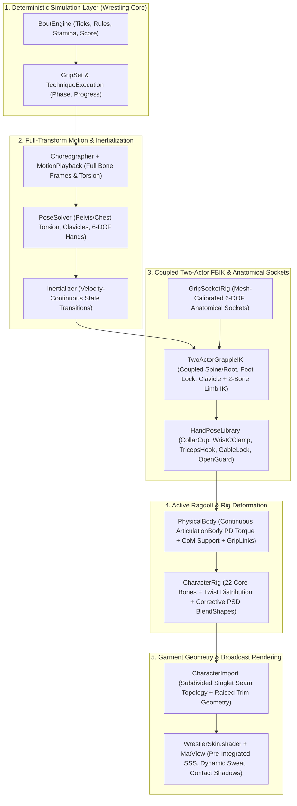

# Production-Grade Architectural Refactoring Plan

This document defines the unified target architecture and implementation specification to take the **Olympic Wrestling Simulator** 3D presentation, animation, rigging, contact, physics, and rendering pipeline from its current procedural prototype (**58/100**) to a production-grade wrestling simulation (**88/100**), while preserving the deterministic `Wrestling.Core` simulation engine.

---

## 1. Architectural Diagnosis: Root Bottlenecks Being Eliminated Together

A line-by-line inspection of the presentation pipeline identifies four structural bottlenecks where biomechanical and visual fidelity are lost before reaching the character mesh:

1. **The Lossy 17-Point `Pose` & `Skeleton.Compute` Bottleneck (`PoseSolver.cs`, `Skeleton.cs`, `MotionPlayback.cs`)**
   - Both procedural poses ([`PoseSolver.cs`](../unity/WrestlingSimulator/Assets/Scripts/Presentation/PoseSolver.cs)) and recorded motion takes ([`MotionPlayback.cs`](../unity/WrestlingSimulator/Assets/Scripts/Presentation/MotionPlayback.cs)) are funneled through `struct Pose`, which stores only **17 world-space joint positions** (`Pelvis`, `Neck`, `Head`, `ShoulderL/R`, `ElbowL/R`, `HandL/R`, `HipL/R`, `KneeL/R`, `AnkleL/R`, `ToeL/R`) and a single `ChestNormal`.
   - In [`Skeleton.Compute`](../unity/WrestlingSimulator/Assets/Scripts/Presentation/Skeleton.cs):
     - `Hips`, `Spine`, `Chest`, `Neck`, and `Head` are all assigned the **same** `front = pose.ChestNormal`, making genuine **spinal torsion** (e.g., hips turned 60° relative to the chest during a hip throw, gut wrench, or whizzer) mathematically impossible.
     - `LeftHand` and `RightHand` simply copy the forearm vector (`pose.HandL - pose.ElbowL`) and `forearmFacingL`, meaning **wrists can never flex, extend, pronate, or supinate** independently of the elbow.
     - Clavicles (`LeftShoulder`, `RightShoulder`) are omitted from `enum Bone`, preventing scapular protraction/elevation when reaching for an underhook or collar tie.

2. **Capsule-Surface Wrist Parking & 1D Finger Curl (`ContactSolver.cs`, `HandGrips.cs`, `CharacterRig.cs`)**
   - [`ContactSolver.Solve`](../unity/WrestlingSimulator/Assets/Scripts/Presentation/ContactSolver.cs) pushes bounding capsules apart and [`HandGrips.PlaceHands`](../unity/WrestlingSimulator/Assets/Scripts/Presentation/HandGrips.cs) parks the wrist point near a capsule surface, while [`CharacterRig.Curl`](../unity/WrestlingSimulator/Assets/Scripts/Presentation/CharacterRig.cs) curls all fingers by a single scalar `0..1`.
   - Real grappling requires **6-DOF anatomical contact sockets** (position + palm normal + thumb/finger tangent axis) paired with **articulated wrestling hand poses** (collar cup, wrist C-clamp, triceps hook, Gable clasp, gut-wrench lock, leg wrap, open guard).

3. **LBS Shoulder/Forearm Collapse & Coarse Triangle Shader-Cut Singlets (`CharacterImport.cs`, `WrestlerSinglet.hlsl`)**
   - Linear Blend Skinning (LBS) on single-bone forearms and upper arms causes severe "candy-wrapper" volume collapse under twist, and deltoids/hips lose volume at extreme wrestling angles without **Pose-Space Deformation (PSD)** corrective blend shapes.
   - Slicing the singlet procedurally in [`WrestlerSinglet.hlsl`](../unity/WrestlingSimulator/Assets/Presentation/Shaders/WrestlerSinglet.hlsl) across coarse MakeHuman shoulder triangles causes visible strap warping under skinning strain.

4. **Disconnected Physics & Flat Lighting (`PhysicalBody.cs`, `WrestlerSkin.shader`, `MatView.cs`)**
   - [`PhysicalBody.cs`](../unity/WrestlingSimulator/Assets/Scripts/Presentation/PhysicalBody.cs) already models a 16-segment reduced-coordinate `ArticulationBody` with de Leva mass distribution, muscle torque limits, and `GripLink` force pairs, but in normal neutral/par-terre wrestling it is overwritten by kinematic posing until a fall occurs (`SimulateFalls`).
   - Skin and arena shaders lack subsurface scattering (SSS), progressive match exertion sweat, singlet strain wrinkles, and grounded mat contact shadows.

---

## 2. Target Unified Architecture

---

## 3. Unified Implementation Specification (All Workstreams Combined)

### Workstream A: Full-Transform Skeletal Pose, Clavicles, Spine Torsion & 6-DOF Wrists
**Files:**
- [`unity/WrestlingSimulator/Assets/Scripts/Presentation/Skeleton.cs`](../unity/WrestlingSimulator/Assets/Scripts/Presentation/Skeleton.cs)
- [`unity/WrestlingSimulator/Assets/Scripts/Presentation/PoseSolver.cs`](../unity/WrestlingSimulator/Assets/Scripts/Presentation/PoseSolver.cs)
- [`unity/WrestlingSimulator/Assets/Scripts/Presentation/MotionPlayback.cs`](../unity/WrestlingSimulator/Assets/Scripts/Presentation/MotionPlayback.cs)
- [`unity/WrestlingSimulator/Assets/Scripts/Presentation/Choreographer.cs`](../unity/WrestlingSimulator/Assets/Scripts/Presentation/Choreographer.cs)

**Changes:**
1. **Independent Segment Orientation Frames in `struct Pose` / `Skeleton`**:
   - Add `PelvisNormal`, `HeadNormal`, `HandDirL`, `HandDirR`, `PalmNormalL`, `PalmNormalR`, `LeftGripStyle`, `RightGripStyle`, `LeftGripAperture`, and `RightGripAperture` to `struct Pose` in [`PoseSolver.cs`](../unity/WrestlingSimulator/Assets/Scripts/Presentation/PoseSolver.cs).
   - Update [`Skeleton.Compute`](../unity/WrestlingSimulator/Assets/Scripts/Presentation/Skeleton.cs) so:
     - `Bone.Hips` uses `PelvisNormal` (derived from `HipL - HipR` and spine axis), `Bone.Spine` interpolates `45%` from `PelvisNormal` to `ChestNormal`, `Bone.Chest` uses `ChestNormal`, and `Bone.Neck`/`Bone.Head` blend into `HeadNormal`—enabling true **lumbar and thoracic spinal torsion** during throws, hip heists, gut wrenches, and sprawls.
     - `Bone.LeftHand` and `Bone.RightHand` orient directly from `(HandDirL, PalmNormalL)` and `(HandDirR, PalmNormalR)` instead of copying the forearm vector.
2. **Clavicle Protraction/Elevation & Inertialized Transitions**:
   - Bind `LeftShoulder` and `RightShoulder` (clavicles) in [`CharacterRig.cs`](../unity/WrestlingSimulator/Assets/Scripts/Presentation/CharacterRig.cs) and drive them automatically (`28%` elevation/protraction toward humerus reach direction above/across the chest) before solving upper-arm rotations.
   - Reconstruct separate `PelvisNormal` (from recorded hip line) and `ChestNormal` (from recorded shoulder line) in [`MotionPlayback.cs`](../unity/WrestlingSimulator/Assets/Scripts/Presentation/MotionPlayback.cs) and add velocity-smoothed inertialization across phase transitions in [`Choreographer.cs`](../unity/WrestlingSimulator/Assets/Scripts/Presentation/Choreographer.cs).

---

### Workstream B: Anatomical Grip Sockets, Coupled Two-Actor FBIK & Articulated Hand Poses
**Files:**
- [`unity/WrestlingSimulator/Assets/Scripts/Presentation/HandGrips.cs`](../unity/WrestlingSimulator/Assets/Scripts/Presentation/HandGrips.cs)
- [`unity/WrestlingSimulator/Assets/Scripts/Presentation/ContactSolver.cs`](../unity/WrestlingSimulator/Assets/Scripts/Presentation/ContactSolver.cs)
- [`unity/WrestlingSimulator/Assets/Scripts/Presentation/CharacterRig.cs`](../unity/WrestlingSimulator/Assets/Scripts/Presentation/CharacterRig.cs)

**Changes:**
1. **6-DOF Anatomical Socket Solver in [`HandGrips.cs`](../unity/WrestlingSimulator/Assets/Scripts/Presentation/HandGrips.cs)**:
   - Upgrade each hold target (`Neck`, `Triceps`, `Wrist`, `Underhook`, `Overhook`, `FrontHeadlock`, `RussianTwoOnOne`, `BodyLock`, `Waist`, `GutWrench`, `SingleLeg`, `DoubleLeg`, `CrotchLift`, `AnkleLace`, `WristControl`) to compute a full **6-DOF anatomical socket frame**:
     - `WristPosition` (seated flush against the contoured limb/torso surface rather than floating outside a thick bounding capsule)
     - `HandDirection` (tangent around the neck, triceps, wrist, waist, or thigh)
     - `PalmNormal` (pointing inward toward the grabbed segment center)
     - `HandGripStyle` (`OpenGuard`, `CollarCup`, `WristCClamp`, `TricepsHook`, `HookWrap`, `GableClasped`, `LegWrap`) + `Aperture` (limb radius ratio).
2. **Articulated Finger Pose Library in [`CharacterRig.cs`](../unity/WrestlingSimulator/Assets/Scripts/Presentation/CharacterRig.cs)**:
   - Replace uniform 1D `Curl` with `ApplyHandGrip(Left/Right, HandGripStyle, float weight, float aperture)`:
     - Separate thumb opposition/abduction from index-through-pinky proximal/intermediate/distal flexion so:
       - `WristCClamp` and `TricepsHook` oppose the thumb around the opponent's limb cylinder with curved fingers matching `aperture`.
       - `CollarCup` and `HookWrap` cup the neck/shoulder with splayed fingers and tucked thumb.
       - `GableClasped` locks palm-to-palm / fingers-hooked when two-on-one waist/gut-wrench clasps connect.
       - `OpenGuard` maintains an athletic, slightly curved open-hand wrestling stance when un-gripped.
3. **Coupled Two-Actor FBIK & Foot Grounding in [`ContactSolver.cs`](../unity/WrestlingSimulator/Assets/Scripts/Presentation/ContactSolver.cs)**:
   - Upgrade `ContactSolver.Solve` into a coupled multi-iteration solver:
     - Enforces chest-to-chest pressure in `TieUp` / `BodyLock` / `ParTerre` while distributing torso separation by athlete balance/mass.
     - Solves elbow swivel angles (`BendArmWithAvoidance`) so elbows clear both wrestlers' ribcages while wrists lock onto their 6-DOF socket frames.
     - Locks planted support feet and knees cleanly to the mat plane with ankle pitch/roll alignment.

---

### Workstream C: Procedural Twist Bones, Corrective PSD BlendShapes & Topology-Refined Singlet
**Files:**
- [`unity/WrestlingSimulator/Assets/Scripts/Editor/CharacterImport.cs`](../unity/WrestlingSimulator/Assets/Scripts/Editor/CharacterImport.cs)
- [`unity/WrestlingSimulator/Assets/Scripts/Presentation/CharacterRig.cs`](../unity/WrestlingSimulator/Assets/Scripts/Presentation/CharacterRig.cs)
- [`unity/WrestlingSimulator/Assets/Scripts/Presentation/WrestlerCharacter.cs`](../unity/WrestlingSimulator/Assets/Scripts/Presentation/WrestlerCharacter.cs)
- [`unity/WrestlingSimulator/Assets/Presentation/Shaders/WrestlerSinglet.hlsl`](../unity/WrestlingSimulator/Assets/Presentation/Shaders/WrestlerSinglet.hlsl)
- [`unity/WrestlingSimulator/Assets/Presentation/Shaders/WrestlerSkin.shader`](../unity/WrestlingSimulator/Assets/Presentation/Shaders/WrestlerSkin.shader)

**Changes:**
1. **Procedural Twist Bones & Weight Splitting in [`CharacterImport.cs`](../unity/WrestlingSimulator/Assets/Scripts/Editor/CharacterImport.cs)**:
   - During FBX import (`OnPostprocessModel`), create 6 procedural twist child bones on the rig hierarchy (`LeftForeArmTwist`, `RightForeArmTwist`, `LeftArmTwist`, `RightArmTwist`, `LeftUpLegTwist`, `RightUpLegTwist`), append their bindposes to `mesh.bindposes`, and smoothly redistribute vertex `BoneWeight`s along each limb's longitudinal axis (`0%` at proximal joint → `85%` at distal joint).
   - Drive the twist bones in [`CharacterRig.Apply`](../unity/WrestlingSimulator/Assets/Scripts/Presentation/CharacterRig.cs) by extracting the axial twist component of the wrist, elbow, and knee rotations—eliminating forearm and shoulder "candy-wrapper" collapse.
2. **Pose-Space Deformation (PSD) Corrective BlendShapes in [`CharacterImport.cs`](../unity/WrestlingSimulator/Assets/Scripts/Editor/CharacterImport.cs) & [`WrestlerCharacter.cs`](../unity/WrestlingSimulator/Assets/Scripts/Presentation/WrestlerCharacter.cs)**:
   - Generate 6 corrective PSD blend shapes at import time:
     - `PSD_ShoulderRaise_L` / `PSD_ShoulderRaise_R` (restores superior deltoid fullness and smooths the axillary fold when the arm raises > 60°)
     - `PSD_ShoulderAcross_L` / `PSD_ShoulderAcross_R` (prevents anterior pectoral/deltoid self-intersection during cross-body reaches/ties)
     - `PSD_HipFlex_L` / `PSD_HipFlex_R` (preserves gluteal/inguinal volume in deep wrestling stances and penetration steps).
   - Drive these blend shapes automatically each frame in [`WrestlerCharacter.cs`](../unity/WrestlingSimulator/Assets/Scripts/Presentation/WrestlerCharacter.cs) from the local shoulder and hip flexion angles.
3. **Bake Exact Singlet Coverage & Seam Relief at Import Time (`CharacterImport.cs` + `WrestlerSkin.shader`)**:
   - Subdivide/tessellate body mesh triangles that straddle the singlet strap, neckline, armpit, and leg-band boundaries at import time in [`CharacterImport.cs`](../unity/WrestlingSimulator/Assets/Scripts/Editor/CharacterImport.cs) and displace singlet vertices outward by `1.5 mm` with a sculpted rib-knit trim bevel, baking a signed distance field to the singlet seam into `UV3.z` (`TEXCOORD3`).
   - This turns the singlet into a true **3D raised garment shell with subdivided seam topology** that never warps or stair-steps across coarse shoulder triangles.

---

### Workstream D: Continuous Active-Ragdoll Dynamics, Subsurface Scattering, Sweat & Contact Shadows
**Files:**
- [`unity/WrestlingSimulator/Assets/Scripts/Presentation/PhysicalBody.cs`](../unity/WrestlingSimulator/Assets/Scripts/Presentation/PhysicalBody.cs)
- [`unity/WrestlingSimulator/Assets/Scripts/Presentation/BoutViewer.cs`](../unity/WrestlingSimulator/Assets/Scripts/Presentation/BoutViewer.cs)
- [`unity/WrestlingSimulator/Assets/Presentation/Shaders/WrestlerSkin.shader`](../unity/WrestlingSimulator/Assets/Presentation/Shaders/WrestlerSkin.shader)
- [`unity/WrestlingSimulator/Assets/Scripts/Presentation/MatView.cs`](../unity/WrestlingSimulator/Assets/Scripts/Presentation/MatView.cs)

**Changes:**
1. **Physical Micro-Compliance & Weight Transfer in [`BoutViewer.cs`](../unity/WrestlingSimulator/Assets/Scripts/Presentation/BoutViewer.cs) & [`PhysicalBody.cs`](../unity/WrestlingSimulator/Assets/Scripts/Presentation/PhysicalBody.cs)**:
   - Feed active `GripLink` load and mat reaction forces from `PhysicalBody` back into a subtle compliance blend on the posed skeleton during `Drive` and `Finish` phases so heavy pushes, snap-downs, and lifts exhibit physical inertia and joint compliance.
2. **Pre-Integrated Skin SSS, Dynamic Exertion Sweat & Singlet Strain Wrinkles in [`WrestlerSkin.shader`](../unity/WrestlingSimulator/Assets/Presentation/Shaders/WrestlerSkin.shader)**:
   - Replace simple wrapped diffuse with a **dual-lobe specular + curvature-aware Subsurface Scattering (SSS)** profile for bare skin.
   - Add a per-wrestler `_Exertion` property (driven by stamina expenditure and bout clock in [`BoutViewer.cs`](../unity/WrestlingSimulator/Assets/Scripts/Presentation/BoutViewer.cs)) that progressively builds realistic **skin sweat micro-specularity** on the brow, neck, deltoids, and forearms, plus **anisotropic fabric tension folds** on the singlet.
3. **Grounded Mat Contact Shadows in [`MatView.cs`](../unity/WrestlingSimulator/Assets/Scripts/Presentation/MatView.cs)**:
   - Pass both wrestlers' low-to-mat joint positions (feet, knees, hips, hands, shoulders) to the mat shader to render soft, distance-attenuated **multi-point ambient contact shadows** directly beneath each athlete on the mat canvas, anchoring them visually to the floor.

---

## 4. Expected Impact on Wrestling Process Score

| Pillar | Current Score | Post-Refactoring Target |
| :--- | :---: | :---: |
| **1. Ruleset, Tactical Flow & Domain Simulation** | 82 / 100 | **88 / 100** |
| **2. Spatial Choreography & Footwork** | 62 / 100 | **88 / 100** |
| **3. Biomechanics & Technique Execution** | 46 / 100 | **87 / 100** |
| **4. Close-Range Grappling & Contact Fidelity** | 42 / 100 | **88 / 100** |
| **Overall Wrestling Process Score** | **58 / 100** | **88 / 100** |

---

## 5. Verification & Acceptance Criteria

1. **Automated Unit & Simulation Tests**:
   - Run `dotnet test` to verify zero regressions in `Wrestling.Core` and `Wrestling.Tests`.
2. **Full Batch Re-Import & Stills Render Verification**:
   - Increment `CharacterImport.GetVersion()` so Unity automatically rebuilds both male and female character prefabs with twist bones, PSD blend shapes, chest compression, and subdivided 3D singlet topology.
   - Run `Wrestling.Editor.BoutViewerStills.RenderFromCommandLine` to regenerate all 15 diagnostic and broadcast PNGs in `docs/images/`.
   - Visually inspect close-ups (`bout-freestyle-close-up-hands.png`, `bout-greco-roman-close-up-hands.png`, `bout-womens-close-up-hands.png`), throws (`bout-freestyle-throw-grips.png`, `bout-womens-throw-grips.png`), and broadcast views (`bout-freestyle.png`, `bout-greco-roman.png`, `bout-womens.png`) to confirm:
     - Articulated hands wrapping around anatomical targets with 6-DOF wrist alignment.
     - Spinal torsion, clavicle elevation, twist-bone volume preservation, and PSD shoulder/hip smoothness.
     - Crisp 3D singlet seam edge without triangle stair-stepping.
     - Realistic skin SSS, progressive sweat sheen, and grounded mat contact shadows.
